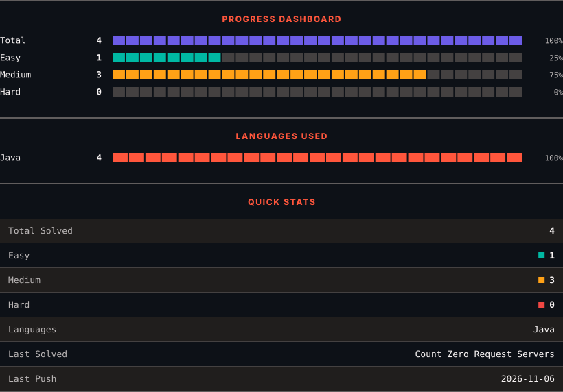
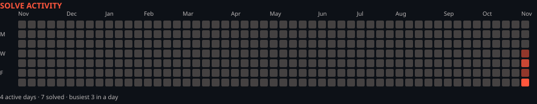

<h1>LeetCode Solutions</h1>

<em>Automatically synced with every accepted submission</em>

   

<picture>
  <source media="(prefers-color-scheme: dark)" srcset=".leetsync/stats-dark.svg">
  <source media="(prefers-color-scheme: light)" srcset=".leetsync/stats-light.svg">
  
</picture>

<picture>
  <source media="(prefers-color-scheme: dark)" srcset=".leetsync/calendar-dark.svg">
  <source media="(prefers-color-scheme: light)" srcset=".leetsync/calendar-light.svg">
  
</picture>

---

### ALL SOLUTIONS

| # | Problem | Difficulty | Language | Date |
|:---:|:--------|:----------:|:--------:|:----:|
| 45 | [Jump Game II](problems/0045-Jump-Game-II) | 🟧 Medium | `Java` | 2026-11-04 |
| 115 | [Distinct Subsequences](problems/0115-Distinct-Subsequences) | 🟥 Hard | `Java` | 2026-11-14 |
| 516 | [Longest Palindromic Subsequence](problems/0516-Longest-Palindromic-Subsequence) | 🟧 Medium | `Java` | 2026-11-07 |
| 583 | [Delete Operation for Two Strings](problems/0583-Delete-Operation-for-Two-Strings) | 🟧 Medium | `Java` | 2026-11-09 |
| 1092 | [Shortest Common Supersequence ](problems/1092-Shortest-Common-Supersequence) | 🟥 Hard | `Java` | 2026-11-13 |
| 1143 | [Longest Common Subsequence](problems/1143-Longest-Common-Subsequence) | 🟧 Medium | `Java` | 2026-11-05 |
| 1267 | [Count Servers that Communicate](problems/1267-Count-Servers-that-Communicate) | 🟧 Medium | `Java` | 2026-11-08 |
| 1312 | [Minimum Insertion Steps to Make a String Palindrome](problems/1312-Minimum-Insertion-Steps-to-Make-a-String-Palindrome) | 🟥 Hard | `Java` | 2026-11-07 |
| 1385 | [Find the Distance Value Between Two Arrays](problems/1385-Find-the-Distance-Value-Between-Two-Arrays) | 🟩 Easy | `Java` | 2026-11-05 |
| 1882 | [Process Tasks Using Servers](problems/1882-Process-Tasks-Using-Servers) | 🟧 Medium | `Java` | 2026-11-07 |
| 2747 | [Count Zero Request Servers](problems/2747-Count-Zero-Request-Servers) | 🟧 Medium | `Java` | 2026-11-06 |
| 3105 | [Longest Strictly Increasing or Strictly Decreasing Subarray](problems/3105-Longest-Strictly-Increasing-or-Strictly-Decreasing-Subarray) | 🟩 Easy | `Java` | 2026-11-12 |

---

Auto-synced by <strong>LeetSync</strong> · Built by <a href="https://deveshsamant.in/">Devesh Samant</a>

