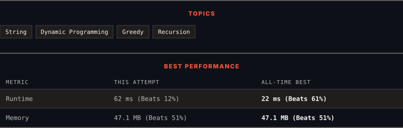

<div align="center">

# 44. Wildcard Matching

      

[](https://leetcode.com/problems/wildcard-matching/)

</div>

---

<div align="center">

<picture>
  <source media="(prefers-color-scheme: dark)" srcset="panel-dark.svg">
  <source media="(prefers-color-scheme: light)" srcset="panel-light.svg">
  
</picture>

</div>

### HOW IT WENT

| | |
|:--|:--|
| **Attempts** | 3 before accepted |
| **Time to solve** | 24 h 5 min |
| **Verdicts** | ❌ Wrong Answer → ✅ Accepted → ✅ Accepted |

---

### NOTES

_No notes yet._

---

### SOLUTIONS (2)

| # | File | Language | Date |
|:-:|------|:--------:|:----:|
| 1 | [sol1.java](./sol1.java) | `Java` | 2026-11-28 |
| 2 | [sol2.java](./sol2.java) | `Java` | 2026-11-28 ← **latest** |

---

### PROBLEM DESCRIPTION

Given an input string (`s`) and a pattern (`p`), implement wildcard pattern matching with support for `'?'` and `'*'` where:

	- `'?'` Matches any single character.

	- `'*'` Matches any sequence of characters (including the empty sequence).

The matching should cover the **entire** input string (not partial).

 

**Example 1:**

```

**Input:** s = "aa", p = "a"
**Output:** false
**Explanation:** "a" does not match the entire string "aa".

```

**Example 2:**

```

**Input:** s = "aa", p = "*"
**Output:** true
**Explanation:** '*' matches any sequence.

```

**Example 3:**

```

**Input:** s = "cb", p = "?a"
**Output:** false
**Explanation:** '?' matches 'c', but the second letter is 'a', which does not match 'b'.

```

 

**Constraints:**

	- `0 <= s.length, p.length <= 2000`

	- `s` contains only lowercase English letters.

	- `p` contains only lowercase English letters, `'?'` or `'*'`.

---

<div align="center">

<sub>Auto-synced by <strong>LeetSync</strong> · Built by <a href="https://deveshsamant.in/">Devesh Samant</a></sub>

</div>
