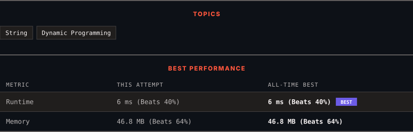

<div align="center">

# 72. Edit Distance

      

[](https://leetcode.com/problems/edit-distance/)

</div>

---

<div align="center">

<picture>
  <source media="(prefers-color-scheme: dark)" srcset="panel-dark.svg">
  <source media="(prefers-color-scheme: light)" srcset="panel-light.svg">
  
</picture>

</div>

> **New personal best** — Runtime improved on this submission.

### HOW IT WENT

| | |
|:--|:--|
| **Attempts** | first try |
| **Time to solve** | 42 min |
| **Verdicts** | ✅ Accepted |

---

### NOTES

_No notes yet._

---

### SOLUTIONS (1)

| # | File | Language | Date |
|:-:|------|:--------:|:----:|
| 1 | [sol1.java](./sol1.java) | `Java` | 2026-11-17 ← **latest** |

---

### PROBLEM DESCRIPTION

Given two strings `word1` and `word2`, return *the minimum number of operations required to convert `word1` to `word2`*.

You have the following three operations permitted on a word:

	- Insert a character

	- Delete a character

	- Replace a character

 

**Example 1:**

```

**Input:** word1 = "horse", word2 = "ros"
**Output:** 3
**Explanation:** 
horse -> rorse (replace 'h' with 'r')
rorse -> rose (remove 'r')
rose -> ros (remove 'e')

```

**Example 2:**

```

**Input:** word1 = "intention", word2 = "execution"
**Output:** 5
**Explanation:** 
intention -> inention (remove 't')
inention -> enention (replace 'i' with 'e')
enention -> exention (replace 'n' with 'x')
exention -> exection (replace 'n' with 'c')
exection -> execution (insert 'u')

```

 

**Constraints:**

	- `0 <= word1.length, word2.length <= 500`

	- `word1` and `word2` consist of lowercase English letters.

---

<div align="center">

<sub>Auto-synced by <strong>LeetSync</strong> · Built by <a href="https://deveshsamant.in/">Devesh Samant</a></sub>

</div>
