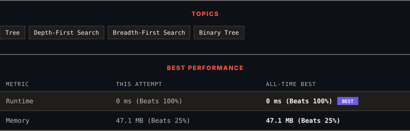

<div align="center">

# 104. Maximum Depth of Binary Tree

      

[](https://leetcode.com/problems/maximum-depth-of-binary-tree/)

</div>

---

<div align="center">

<picture>
  <source media="(prefers-color-scheme: dark)" srcset="panel-dark.svg">
  <source media="(prefers-color-scheme: light)" srcset="panel-light.svg">
  
</picture>

</div>

> **New personal best** — Runtime improved on this submission.

### HOW IT WENT

| | |
|:--|:--|
| **Attempts** | first try |
| **Time to solve** | 5 min |
| **Verdicts** | ✅ Accepted |

---

### NOTES

_No notes yet._

---

### SOLUTIONS (1)

| # | File | Language | Date |
|:-:|------|:--------:|:----:|
| 1 | [sol1.java](./sol1.java) | `Java` | 2026-11-16 ← **latest** |

---

### PROBLEM DESCRIPTION

Given the `root` of a binary tree, return *its maximum depth*.

A binary tree's **maximum depth** is the number of nodes along the longest path from the root node down to the farthest leaf node.

 

**Example 1:**


```

**Input:** root = [3,9,20,null,null,15,7]
**Output:** 3

```

**Example 2:**

```

**Input:** root = [1,null,2]
**Output:** 2

```

 

**Constraints:**

	- The number of nodes in the tree is in the range `[0, 10^4]`.

	- `-100 <= Node.val <= 100`

---

<div align="center">

<sub>Auto-synced by <strong>LeetSync</strong> · Built by <a href="https://deveshsamant.in/">Devesh Samant</a></sub>

</div>
