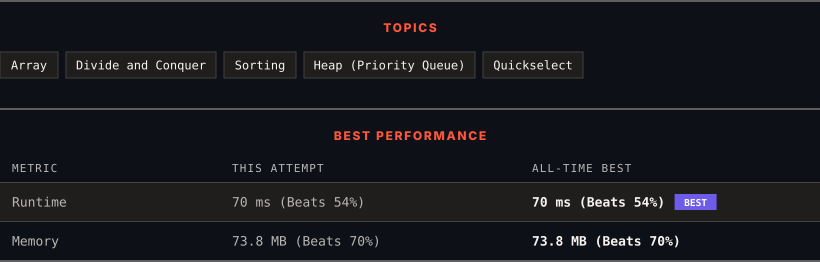

<div align="center">

# 215. Kth Largest Element in an Array

      

[](https://leetcode.com/problems/kth-largest-element-in-an-array/)

</div>

---

<div align="center">

<picture>
  <source media="(prefers-color-scheme: dark)" srcset="panel-dark.svg">
  <source media="(prefers-color-scheme: light)" srcset="panel-light.svg">
  
</picture>

</div>

> **New personal best** — Runtime improved on this submission.

### HOW IT WENT

| | |
|:--|:--|
| **Attempts** | first try |
| **Time to solve** | 2 h 36 min |
| **Verdicts** | ✅ Accepted |

---

### NOTES

_No notes yet._

---

### SOLUTIONS (1)

| # | File | Language | Date |
|:-:|------|:--------:|:----:|
| 1 | [sol1.java](./sol1.java) | `Java` | 2026-11-22 ← **latest** |

---

### PROBLEM DESCRIPTION

Given an integer array `nums` and an integer `k`, return *the* `k^th` *largest element in the array*.

Note that it is the `k^th` largest element in the sorted order, not the `k^th` distinct element.

Can you solve it without sorting?

 

**Example 1:**

```
**Input:** nums = [3,2,1,5,6,4], k = 2
**Output:** 5

```

**Example 2:**

```
**Input:** nums = [3,2,3,1,2,4,5,5,6], k = 4
**Output:** 4

```

 

**Constraints:**

	- `1 <= k <= nums.length <= 10^5`

	- `-10^4 <= nums[i] <= 10^4`

---

<div align="center">

<sub>Auto-synced by <strong>LeetSync</strong> · Built by <a href="https://deveshsamant.in/">Devesh Samant</a></sub>

</div>
