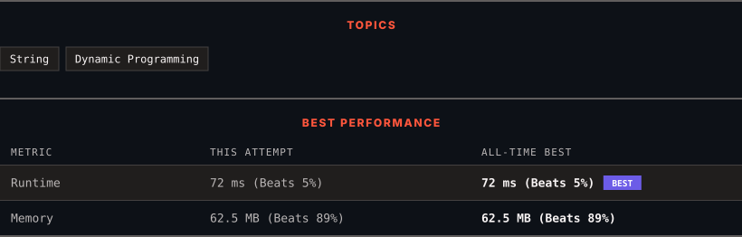

<div align="center">

# 516. Longest Palindromic Subsequence

      

[](https://leetcode.com/problems/longest-palindromic-subsequence/)

</div>

---

<div align="center">

<picture>
  <source media="(prefers-color-scheme: dark)" srcset="panel-dark.svg">
  <source media="(prefers-color-scheme: light)" srcset="panel-light.svg">
  
</picture>

</div>

> **New personal best** — Runtime improved on this submission.

### HOW IT WENT

| | |
|:--|:--|
| **Attempts** | first try |
| **Time to solve** | 8 min |
| **Verdicts** | ✅ Accepted |

---

### NOTES

_No notes yet._

---

### SOLUTIONS (1)

| # | File | Language | Date |
|:-:|------|:--------:|:----:|
| 1 | [sol1.java](./sol1.java) | `Java` | 2026-11-07 ← **latest** |

---

### PROBLEM DESCRIPTION

Given a string `s`, find *the longest palindromic **subsequence**'s length in* `s`.

A **subsequence** is a sequence that can be derived from another sequence by deleting some or no elements without changing the order of the remaining elements.

 

**Example 1:**

```

**Input:** s = "bbbab"
**Output:** 4
**Explanation:** One possible longest palindromic subsequence is "bbbb".

```

**Example 2:**

```

**Input:** s = "cbbd"
**Output:** 2
**Explanation:** One possible longest palindromic subsequence is "bb".

```

 

**Constraints:**

	- `1 <= s.length <= 1000`

	- `s` consists only of lowercase English letters.

---

<div align="center">

<sub>Auto-synced by <strong>LeetSync</strong> · Built by <a href="https://deveshsamant.in/">Devesh Samant</a></sub>

</div>
