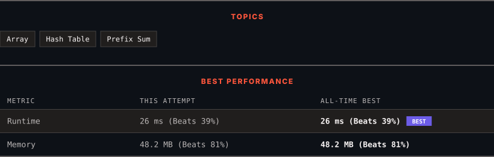

<div align="center">

# 560. Subarray Sum Equals K

      

[](https://leetcode.com/problems/subarray-sum-equals-k/)

</div>

---

<div align="center">

<picture>
  <source media="(prefers-color-scheme: dark)" srcset="panel-dark.svg">
  <source media="(prefers-color-scheme: light)" srcset="panel-light.svg">
  
</picture>

</div>

> **New personal best** — Runtime improved on this submission.

### HOW IT WENT

| | |
|:--|:--|
| **Attempts** | first try |
| **Time to solve** | 36 min |
| **Verdicts** | ✅ Accepted |

---

### NOTES

_No notes yet._

---

### SOLUTIONS (1)

| # | File | Language | Date |
|:-:|------|:--------:|:----:|
| 1 | [sol1.java](./sol1.java) | `Java` | 2026-11-22 ← **latest** |

---

### PROBLEM DESCRIPTION

Given an array of integers `nums` and an integer `k`, return *the total number of subarrays whose sum equals to* `k`.

A subarray is a contiguous **non-empty** sequence of elements within an array.

 

**Example 1:**

```
**Input:** nums = [1,1,1], k = 2
**Output:** 2

```

**Example 2:**

```
**Input:** nums = [1,2,3], k = 3
**Output:** 2

```

 

**Constraints:**

	- `1 <= nums.length <= 2 * 10^4`

	- `-1000 <= nums[i] <= 1000`

	- `-10^7 <= k <= 10^7`

---

<div align="center">

<sub>Auto-synced by <strong>LeetSync</strong> · Built by <a href="https://deveshsamant.in/">Devesh Samant</a></sub>

</div>
