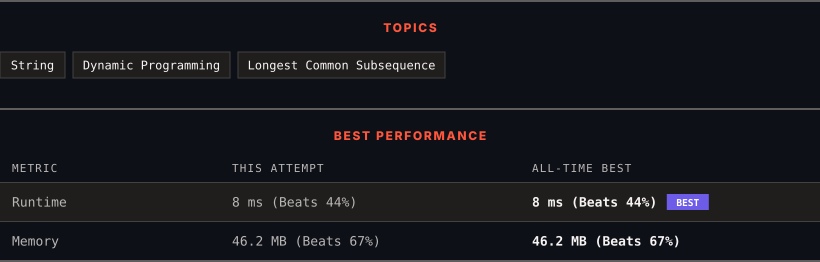

<div align="center">

# 583. Delete Operation for Two Strings

      

[](https://leetcode.com/problems/delete-operation-for-two-strings/)

</div>

---

<div align="center">

<picture>
  <source media="(prefers-color-scheme: dark)" srcset="panel-dark.svg">
  <source media="(prefers-color-scheme: light)" srcset="panel-light.svg">
  
</picture>

</div>

> **New personal best** — Runtime improved on this submission.

### HOW IT WENT

| | |
|:--|:--|
| **Attempts** | first try |
| **Time to solve** | 47 min |
| **Verdicts** | ✅ Accepted |

---

### NOTES

_No notes yet._

---

### SOLUTIONS (1)

| # | File | Language | Date |
|:-:|------|:--------:|:----:|
| 1 | [sol1.java](./sol1.java) | `Java` | 2026-11-09 ← **latest** |

---

### PROBLEM DESCRIPTION

Given two strings `word1` and `word2`, return *the minimum number of **steps** required to make* `word1` *and* `word2` *the same*.

In one **step**, you can delete exactly one character in either string.

 

**Example 1:**

```

**Input:** word1 = "sea", word2 = "eat"
**Output:** 2
**Explanation:** You need one step to make "sea" to "ea" and another step to make "eat" to "ea".

```

**Example 2:**

```

**Input:** word1 = "leetcode", word2 = "etco"
**Output:** 4

```

 

**Constraints:**

	- `1 <= word1.length, word2.length <= 500`

	- `word1` and `word2` consist of only lowercase English letters.

---

<div align="center">

<sub>Auto-synced by <strong>LeetSync</strong> · Built by <a href="https://deveshsamant.in/">Devesh Samant</a></sub>

</div>
