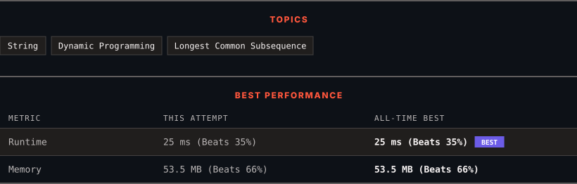

<div align="center">

# 1092. Shortest Common Supersequence 

      

[](https://leetcode.com/problems/shortest-common-supersequence/)

</div>

---

<div align="center">

<picture>
  <source media="(prefers-color-scheme: dark)" srcset="panel-dark.svg">
  <source media="(prefers-color-scheme: light)" srcset="panel-light.svg">
  
</picture>

</div>

> **New personal best** — Runtime improved on this submission.

### HOW IT WENT

| | |
|:--|:--|
| **Attempts** | first try |
| **Time to solve** | 18 min |
| **Verdicts** | ✅ Accepted |

---

### NOTES

_No notes yet._

---

### SOLUTIONS (1)

| # | File | Language | Date |
|:-:|------|:--------:|:----:|
| 1 | [sol1.java](./sol1.java) | `Java` | 2026-11-13 ← **latest** |

---

### PROBLEM DESCRIPTION

Given two strings `str1` and `str2`, return *the shortest string that has both *`str1`* and *`str2`* as **subsequences***. If there are multiple valid strings, return **any** of them.

A string `s` is a **subsequence** of string `t` if deleting some number of characters from `t` (possibly `0`) results in the string `s`.

 

**Example 1:**

```

**Input:** str1 = "abac", str2 = "cab"
**Output:** "cabac"
**Explanation:** 
str1 = "abac" is a subsequence of "cabac" because we can delete the first "c".
str2 = "cab" is a subsequence of "cabac" because we can delete the last "ac".
The answer provided is the shortest such string that satisfies these properties.

```

**Example 2:**

```

**Input:** str1 = "aaaaaaaa", str2 = "aaaaaaaa"
**Output:** "aaaaaaaa"

```

 

**Constraints:**

	- `1 <= str1.length, str2.length <= 1000`

	- `str1` and `str2` consist of lowercase English letters.

---

<div align="center">

<sub>Auto-synced by <strong>LeetSync</strong> · Built by <a href="https://deveshsamant.in/">Devesh Samant</a></sub>

</div>
