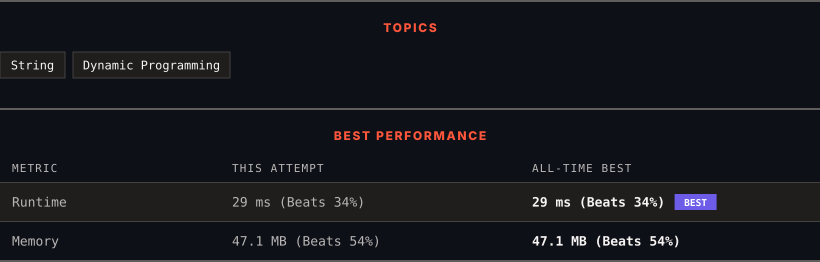

<div align="center">

# 1312. Minimum Insertion Steps to Make a String Palindrome

      

[](https://leetcode.com/problems/minimum-insertion-steps-to-make-a-string-palindrome/)

</div>

---

<div align="center">

<picture>
  <source media="(prefers-color-scheme: dark)" srcset="panel-dark.svg">
  <source media="(prefers-color-scheme: light)" srcset="panel-light.svg">
  
</picture>

</div>

> **New personal best** — Runtime improved on this submission.

### HOW IT WENT

| | |
|:--|:--|
| **Attempts** | first try |
| **Time to solve** | 3 min |
| **Verdicts** | ✅ Accepted |

---

### NOTES

_No notes yet._

---

### SOLUTIONS (1)

| # | File | Language | Date |
|:-:|------|:--------:|:----:|
| 1 | [sol1.java](./sol1.java) | `Java` | 2026-11-07 ← **latest** |

---

### PROBLEM DESCRIPTION

Given a string `s`. In one step you can insert any character at any index of the string.

Return *the minimum number of steps* to make `s` palindrome.

A **Palindrome String** is one that reads the same backward as well as forward.

 

**Example 1:**

```

**Input:** s = "zzazz"
**Output:** 0
**Explanation:** The string "zzazz" is already palindrome we do not need any insertions.

```

**Example 2:**

```

**Input:** s = "mbadm"
**Output:** 2
**Explanation:** String can be "mbdadbm" or "mdbabdm".

```

**Example 3:**

```

**Input:** s = "leetcode"
**Output:** 5
**Explanation:** Inserting 5 characters the string becomes "leetcodocteel".

```

 

**Constraints:**

	- `1 <= s.length <= 500`

	- `s` consists of lowercase English letters.

---

<div align="center">

<sub>Auto-synced by <strong>LeetSync</strong> · Built by <a href="https://deveshsamant.in/">Devesh Samant</a></sub>

</div>
