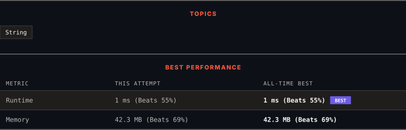

<div align="center">

# 2124. Check if All A's Appears Before All B's

      

[](https://leetcode.com/problems/check-if-all-as-appears-before-all-bs/)

</div>

---

<div align="center">

<picture>
  <source media="(prefers-color-scheme: dark)" srcset="panel-dark.svg">
  <source media="(prefers-color-scheme: light)" srcset="panel-light.svg">
  
</picture>

</div>

> **New personal best** — Runtime improved on this submission.

### HOW IT WENT

| | |
|:--|:--|
| **Attempts** | first try |
| **Time to solve** | 2 min |
| **Verdicts** | ✅ Accepted |

---

### NOTES

_No notes yet._

---

### SOLUTIONS (1)

| # | File | Language | Date |
|:-:|------|:--------:|:----:|
| 1 | [sol1.java](./sol1.java) | `Java` | 2026-11-22 ← **latest** |

---

### PROBLEM DESCRIPTION

Given a string `s` consisting of **only** the characters `'a'` and `'b'`, return `true` *if **every** *`'a'` *appears before **every** *`'b'`* in the string*. Otherwise, return `false`.

 

**Example 1:**

```

**Input:** s = "aaabbb"
**Output:** true
**Explanation:**
The 'a's are at indices 0, 1, and 2, while the 'b's are at indices 3, 4, and 5.
Hence, every 'a' appears before every 'b' and we return true.

```

**Example 2:**

```

**Input:** s = "abab"
**Output:** false
**Explanation:**
There is an 'a' at index 2 and a 'b' at index 1.
Hence, not every 'a' appears before every 'b' and we return false.

```

**Example 3:**

```

**Input:** s = "bbb"
**Output:** true
**Explanation:**
There are no 'a's, hence, every 'a' appears before every 'b' and we return true.

```

 

**Constraints:**

	- `1 <= s.length <= 100`

	- `s[i]` is either `'a'` or `'b'`.

---

<div align="center">

<sub>Auto-synced by <strong>LeetSync</strong> · Built by <a href="https://deveshsamant.in/">Devesh Samant</a></sub>

</div>
