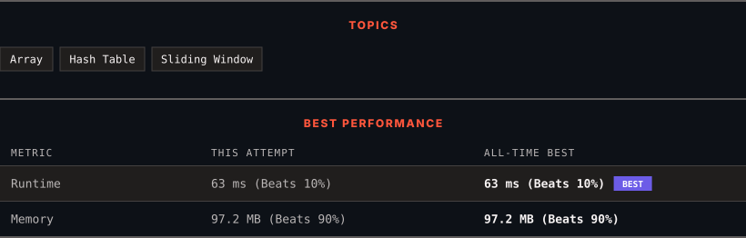

<div align="center">

# 2461. Maximum Sum of Distinct Subarrays With Length K

      

[](https://leetcode.com/problems/maximum-sum-of-distinct-subarrays-with-length-k/)

</div>

---

<div align="center">

<picture>
  <source media="(prefers-color-scheme: dark)" srcset="panel-dark.svg">
  <source media="(prefers-color-scheme: light)" srcset="panel-light.svg">
  
</picture>

</div>

> **New personal best** — Runtime improved on this submission.

### HOW IT WENT

| | |
|:--|:--|
| **Attempts** | first try |
| **Time to solve** | 7 h 14 min |
| **Verdicts** | ✅ Accepted |

---

### NOTES

_No notes yet._

---

### SOLUTIONS (1)

| # | File | Language | Date |
|:-:|------|:--------:|:----:|
| 1 | [sol1.java](./sol1.java) | `Java` | 2026-11-21 ← **latest** |

---

### PROBLEM DESCRIPTION

You are given an integer array `nums` and an integer `k`. Find the maximum subarray sum of all the subarrays of `nums` that meet the following conditions:

	- The length of the subarray is `k`, and

	- All the elements of the subarray are **distinct**.

Return *the maximum subarray sum of all the subarrays that meet the conditions**.* If no subarray meets the conditions, return `0`.

*A **subarray** is a contiguous non-empty sequence of elements within an array.*

 

**Example 1:**

```

**Input:** nums = [1,5,4,2,9,9,9], k = 3
**Output:** 15
**Explanation:** The subarrays of nums with length 3 are:
- [1,5,4] which meets the requirements and has a sum of 10.
- [5,4,2] which meets the requirements and has a sum of 11.
- [4,2,9] which meets the requirements and has a sum of 15.
- [2,9,9] which does not meet the requirements because the element 9 is repeated.
- [9,9,9] which does not meet the requirements because the element 9 is repeated.
We return 15 because it is the maximum subarray sum of all the subarrays that meet the conditions

```

**Example 2:**

```

**Input:** nums = [4,4,4], k = 3
**Output:** 0
**Explanation:** The subarrays of nums with length 3 are:
- [4,4,4] which does not meet the requirements because the element 4 is repeated.
We return 0 because no subarrays meet the conditions.

```

 

**Constraints:**

	- `1 <= k <= nums.length <= 10^5`

	- `1 <= nums[i] <= 10^5`

---

<div align="center">

<sub>Auto-synced by <strong>LeetSync</strong> · Built by <a href="https://deveshsamant.in/">Devesh Samant</a></sub>

</div>
