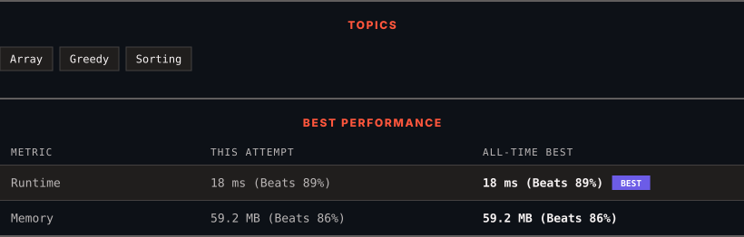

# 2567. Minimum Score by Changing Two Elements

      

---

<picture>
  <source media="(prefers-color-scheme: dark)" srcset="panel-dark.svg">
  <source media="(prefers-color-scheme: light)" srcset="panel-light.svg">
  
</picture>

> **New personal best** — Runtime improved on this submission.

### HOW IT WENT

| | |
|:--|:--|
| **Attempts** | first try |
| **Time to solve** | 47 min |
| **Verdicts** | ✅ Accepted |

---

### NOTES

_No notes yet._

---

### SOLUTIONS (1)

| # | File | Language | Date |
|:-:|------|:--------:|:----:|
| 1 | [sol1.java](./sol1.java) | `Java` | 2026-11-19 ← **latest** |

---

### PROBLEM DESCRIPTION

You are given an integer array `nums`.

	- The **low** score of `nums` is the **minimum** absolute difference between any two integers.

	- The **high** score of `nums` is the **maximum** absolute difference between any two integers.

	- The **score** of `nums` is the sum of the **high** and **low** scores.

Return the **minimum score** after **changing two elements** of `nums`.

 

**Example 1:**

**Input:** nums = [1,4,7,8,5]

**Output:** 3

**Explanation:**

	- Change `nums[0]` and `nums[1]` to be 6 so that `nums` becomes [6,6,7,8,5].

	- The low score is the minimum absolute difference: |6 - 6| = 0.

	- The high score is the maximum absolute difference: |8 - 5| = 3.

	- The sum of high and low score is 3.

**Example 2:**

**Input:** nums = [1,4,3]

**Output:** 0

**Explanation:**

	- Change `nums[1]` and `nums[2]` to 1 so that `nums` becomes [1,1,1].

	- The sum of maximum absolute difference and minimum absolute difference is 0.

 

**Constraints:**

	- `3 <= nums.length <= 10^5`

	- `1 <= nums[i] <= 10^9`

---

Auto-synced by <strong>LeetSync</strong> · Built by <a href="https://deveshsamant.in/">Devesh Samant</a>

