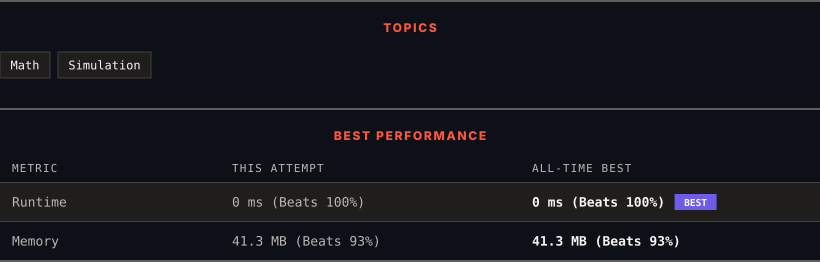

# 3360. Stone Removal Game

      

---

<picture>
  <source media="(prefers-color-scheme: dark)" srcset="panel-dark.svg">
  <source media="(prefers-color-scheme: light)" srcset="panel-light.svg">
  
</picture>

> **New personal best** — Runtime improved on this submission.

### HOW IT WENT

| | |
|:--|:--|
| **Attempts** | first try |
| **Time to solve** | 10 min |
| **Verdicts** | ✅ Accepted |

---

### NOTES

_No notes yet._

---

### SOLUTIONS (1)

| # | File | Language | Date |
|:-:|------|:--------:|:----:|
| 1 | [sol1.java](./sol1.java) | `Java` | 2026-11-26 ← **latest** |

---

### PROBLEM DESCRIPTION

Alice and Bob are playing a game where they take turns removing stones from a pile, with *Alice going first*.

	- Alice starts by removing **exactly** 10 stones on her first turn.

	- For each subsequent turn, each player removes **exactly** 1 fewer** **stone** **than the previous opponent.

The player who cannot make a move loses the game.

Given a positive integer `n`, return `true` if Alice wins the game and `false` otherwise.

 

**Example 1:**

**Input:** n = 12

**Output:** true

**Explanation:**

	- Alice removes 10 stones on her first turn, leaving 2 stones for Bob.

	- Bob cannot remove 9 stones, so Alice wins.

**Example 2:**

**Input:** n = 1

**Output:** false

**Explanation:**

	- Alice cannot remove 10 stones, so Alice loses.

 

**Constraints:**

	- `1 <= n <= 50`

---

Auto-synced by <strong>LeetSync</strong> · Built by <a href="https://deveshsamant.in/">Devesh Samant</a>

